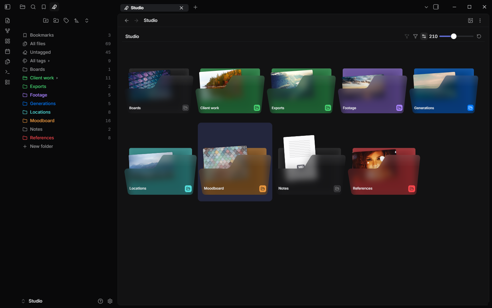
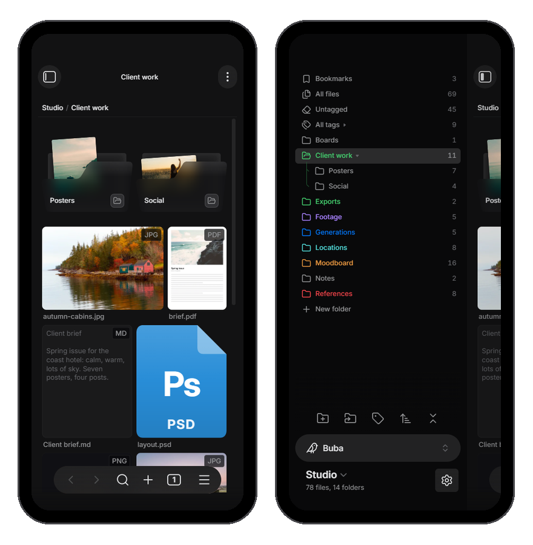

# Buba theme for Obsidian

A calm dark theme for Obsidian, made to go with the [Buba](https://github.com/Opus721/obsidian-buba) plugin and inspired by Linear.

- **Quiet text.** Labels and sidebar items are grey and turn white under the pointer or when open, so the content stands out and the interface does not.
- **Frame and panel.** A near-black window frame holds a slightly lighter rounded panel for your notes and views. Tabs are small pills, menus are rounded and dark.
- **Inter** for the interface and for notes: the copy that ships with Obsidian, so the theme stays small and loads nothing from the internet.
- **Made for Buba.** Folder and file tiles sit calmly on the dark panel, tags are round pills, the file panel reads like a property list. The theme works without Buba too.
- **Core views and popular plugins.** Canvas controls, graph, Bases, properties, callouts, tables, search and link previews share the same look, and so do Excalidraw, Tasks, Omnisearch, Notebook Navigator, TaskNotes, Editing Toolbar, Advanced Canvas and Git.
- **Phone and tablet.** Menus, the command palette, suggestions and the bottom bar are frosted glass, menu groups are cards, and text fields are tall enough for a finger.
- Desktop, phone and tablet. Dark mode only: in light mode Obsidian's own look stays.

## Install

In Obsidian open **Settings → Appearance → Themes → Manage**, find **Buba** and select **Install and use**. Switch **Base color scheme** to **Dark**.

## Buba tree

With Buba 1.1.0 or later, the Buba tree has no arrow column on the left: a small arrow follows the folder or tag group name, as in Linear's sidebar, and shows whether it is open, like the closed or open folder icon. A click or tap on the icon opens or closes the folder, a double click on the name too. Tree lines follow Buba's own setting (**Settings → Buba → Tree → Lines**: off, grey or in the folder color) and look like Linear's sidebar: each line bends into its row with a short slant, and the path to the open folder is drawn brighter, in the color of each folder it passes. With the [Style Settings](https://github.com/mgmeyers/obsidian-style-settings) plugin, under **Buba theme**, you can switch to rounded corners and to thick 2 px lines.

## Excalidraw

Excalidraw colors its toolbars itself while its **Dynamic styling** setting is on. To get the theme's dark toolbars, open Excalidraw's settings, go to **Theme and styling**, set **Dynamic styling** to **Dynamic Styling OFF** and turn on **New drawing to match Obsidian theme** and **Existing drawings to match Obsidian theme**.

## License

MIT, see [LICENSE](LICENSE).
