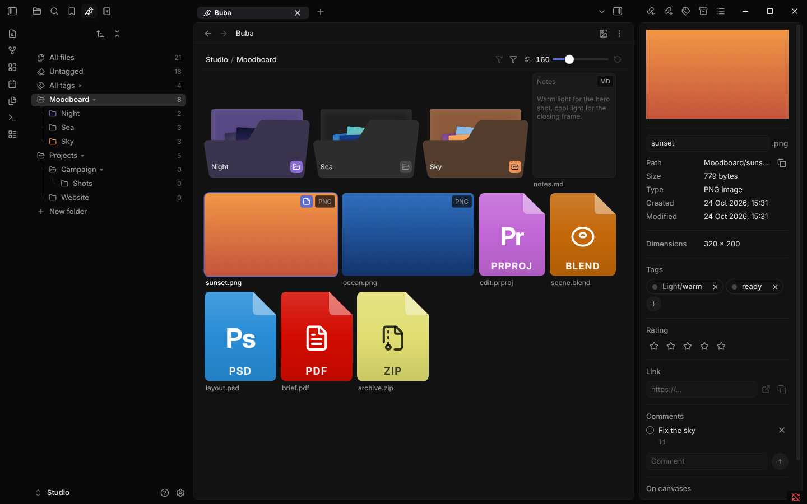

# Buba theme for Obsidian

A calm dark theme for Obsidian, made to go with the [Buba](https://github.com/Opus721/obsidian-buba) plugin and inspired by Linear.

- **Quiet text.** Labels and sidebar items are grey and turn white under the pointer or when open, so the content stands out and the interface does not.
- **Frame and panel.** A near-black window frame holds a slightly lighter rounded panel for your notes and views. Tabs are small pills, menus are rounded and dark.
- **Inter** for the interface and for notes: the copy that ships with Obsidian, so the theme stays small and loads nothing from the internet.
- **Made for Buba.** Grid tiles are quiet cards, tags are round pills, the file panel reads like a property list. The theme works without Buba too.
- Desktop, phone and tablet. Dark mode only: in light mode Obsidian's own look stays.

## Install

In Obsidian open **Settings → Appearance → Themes → Manage**, find **Buba** and select **Install and use**. Switch **Base color scheme** to **Dark**.

## License

MIT, see [LICENSE](LICENSE).
